# Samples

Small sample images to try the overlapping model with. Each one shows a different
aspect of the algorithm: pattern size, rotations, colors, transparency and the
limits of what a sample can generate.

The sample PNGs in this directory are only a few pixels in size. The images under
`preview/` are enlarged copies for this page: samples 12x, generated outputs 4x.

All commands are run from the repository root and are reproducible through `--seed`.
After installing the gem, use `wfc` instead of `bundle exec exe/wfc`.

| Sample | Size | Shows |
| --- | --- | --- |
| [stripes](#stripes) | 6x6 | the effect of rotations |
| [checker](#checker) | 4x4 | a fully determined pattern |
| [maze](#maze) | 8x8 | line structures with N = 3 |
| [flowers](#flowers) | 9x8 | a directed image, generated without rotations |
| [islands](#islands) | 10x9 | coloured areas with many patterns |
| [alpha](#alpha) | 6x6 | transparency, and a sample that cannot grow with N = 3 |
| [bricks](#bricks) | 9x5 | a non-square sample |

## From Ruby

Every CLI example below has the same shape in Ruby:

```ruby
require "wfc"
require "wfc/png"

sample = Wfc::PNG.load("samples/maze.png")
model  = Wfc::OverlappingModel.new(sample, pattern_size: 3, rotations: true)
pixels = model.generate(width: 48, height: 48, seed: 1)
Wfc::PNG.save(pixels, "maze-out.png")
```

`--no-rotations` corresponds to `rotations: false`, `-n` to `pattern_size:` and
`-s WxH` to `width:` / `height:`.

## stripes

Vertical black and white stripes.

| Sample | Output |
| --- | --- |
| 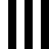 |  |

    $ bundle exec exe/wfc -i samples/stripes.png -o stripes-out.png -n 2 -s 48x48 --seed 1

With rotations (the default) the model also learns the horizontal variant, so the
result consists of either vertical or horizontal stripes, depending on the seed.
The two never mix, because no pattern connects them. With `--no-rotations` the
stripes are always vertical, as in the sample.

## checker

A checkerboard.

| Sample | Output |
| --- | --- |
| 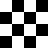 | 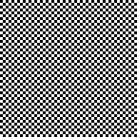 |

    $ bundle exec exe/wfc -i samples/checker.png -o checker-out.png -n 2 -s 48x48 --seed 1

There are only two 2x2 patterns, and each one fixes all of its neighbours. The first
choice decides the whole image, so the only variation between seeds is which colour
ends up in the top-left corner.

## maze

A spiral of black lines on white.

| Sample | Output |
| --- | --- |
|  | 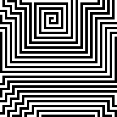 |

    $ bundle exec exe/wfc -i samples/maze.png -o maze-out.png -n 3 -s 48x48 --seed 1

With N = 3 (48 patterns) the lines keep their width and spacing, and the result is
made of nested spirals and corners. With `-n 2` the patterns are too small to keep
that structure, and the output looks like a denser, irregular maze.

## flowers

Flowers on a strip of ground under a blue sky.

| Sample | Output |
| --- | --- |
| 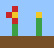 | 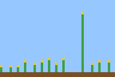 |

    $ bundle exec exe/wfc -i samples/flowers.png -o flowers-out.png -n 3 --no-rotations -s 48x32 --seed 3

This sample has an up and a down, so it is generated with `--no-rotations`. The
ground stays at the bottom and the stems grow upwards, to varying heights. With
rotations enabled the ground and the stems would also run sideways.

## islands

Green islands with a sandy beach in blue water.

| Sample | Output |
| --- | --- |
| 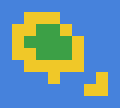 | 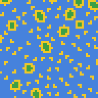 |

    $ bundle exec exe/wfc -i samples/islands.png -o islands-out.png -n 3 -s 48x48 --seed 1

The richest sample here: 153 patterns with N = 3 and rotations. Green only ever
appears inside a ring of sand, as in the sample. Because there are so many patterns,
a single attempt can end in a contradiction; `--attempts` (default 10) covers that.

## alpha

A half-transparent blue frame around an opaque blue core, on a fully transparent
background.

| Sample | Output |
| --- | --- |
|  | 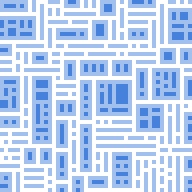 |

    $ bundle exec exe/wfc -i samples/alpha.png -o alpha-out.png -n 2 -s 48x48 --seed 1

Pixels are compared as full RGBA values, so the three levels of transparency are
kept exactly and behave like three colours.

This sample also shows a limit. With `-n 3` only a 6x6 image can be generated, which
is the sample itself:

    $ bundle exec exe/wfc -i samples/alpha.png -n 3 -s 7x6
    wfc: the patterns cannot fill a 7x6 image (Contradiction at [1, 3]: no pattern fits this cell)

Patterns are not read across the edges of the sample, and the transparent border is
only one pixel wide. There is therefore no 3x3 pattern that could continue the image
beyond the border.

## bricks

Orange bricks with grey mortar. The sample is not square (9x5).

| Sample | Output |
| --- | --- |
| 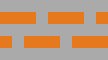 | 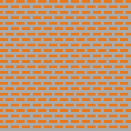 |

    $ bundle exec exe/wfc -i samples/bricks.png -o bricks-out.png -n 3 --no-rotations -s 48x48 --seed 1

Without rotations the bricks stay horizontal and form a wall. The 8 patterns do not
fix how the rows are shifted against each other, so the bond is less regular than in
the sample. With rotations enabled, upright bricks appear as well.
